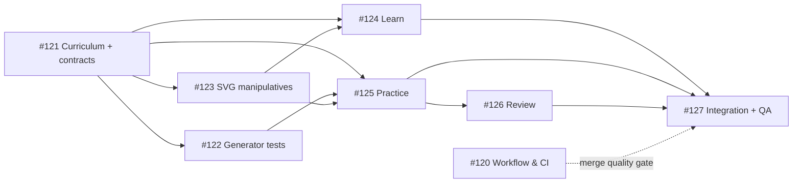

# MindForge Math Learning V1 — incremental implementation plan

> Status: **Planned; not installed or running**.  
> Epic: [#119](https://github.com/buianhtai/buianhtai.github.io/issues/119).  
> Existing Math Quest: `public/mindforge/arcade/math/index.html`.  
> Workflow inspiration: [super-board](https://github.com/EricTechPro/super-board), not an educational whiteboard.

## Objective

Turn Math Quest from a collection of correct, randomly generated arithmetic questions into **interactive visual lessons and concept-based practice**, without changing or deleting the current Quick Sums, Missing Number, Mini Market, Auto Next, local scores or VI/EN mode.

**Minimum valuable release:** three early-math topics — count to 10, compare groups up to 10, number bonds to 10 — with Learn, Practice and Review; roughly ages 5–7 as nonbinding guidance.

## What the child experiences

1. **Choose topic:** Count · Compare · Make 10, presented with illustrative thumbnails and short instruction.
2. **Learn:** Show a short example using counters or ten-frame → ask child to manipulate the objects → give strategy feedback and let child advance.
3. **Practice:** Generate a verified fresh question and accept taps or number input; after a correct answer, briefly show feedback and optionally Auto Next; after an error, allow retry and explain.
4. **Review:** Present a different example of previously missed concepts. Show descriptive progress locally and give parent/child reset control.

**Future:** grade 1–3 extensions, optional Challenge/mock exams, voice question playback and parent reports. These should be gated on a working MVP and direct user feedback, not included in the first release.

## Work breakdown

| Wave | Task | GitHub issue | Depends on | Acceptance gate |
| --- | --- | --- | --- | --- |
| 0 | Super-board readiness + safe verification | [#120](https://github.com/buianhtai/buianhtai.github.io/issues/120) | None | Runnable CI checks, no unapproved auto merge |
| 0 | Original curriculum & versioned typed contracts | [#121](https://github.com/buianhtai/buianhtai.github.io/issues/121) | None | Counting/compare/bond fixtures in EN/VI |
| 0 | Seeded math + browser regression tests | [#122](https://github.com/buianhtai/buianhtai.github.io/issues/122) | #121 | 1k generated tests per topic; failure seeds |
| 1 | Reusable interactive SVG manipulatives | [#123](https://github.com/buianhtai/buianhtai.github.io/issues/123) | #121 | Ten-frame/compare/number-line keyboard + touch |
| 1 | Learn MVP: 3 guided mini-lessons | [#124](https://github.com/buianhtai/buianhtai.github.io/issues/124) | #121, #123 | Three lessons and comprehension checks |
| 2 | Topic-based Practice & validated generator | [#125](https://github.com/buianhtai/buianhtai.github.io/issues/125) | #121, #122, #123 | No unsolvable tasks; complete 3 topics |
| 2 | Mistake review + offline local activity | [#126](https://github.com/buianhtai/buianhtai.github.io/issues/126) | #125 | Correct review queue + no leaked personal data |
| 3 | Navigation, accessibility + staged release QA | [#127](https://github.com/buianhtai/buianhtai.github.io/issues/127) | #124, #125, #126 | E2E, mobile, Safari/Android, no regressions |

### Dependency graph



## Design/architecture

```text
Math Quest shell / topic selector
  ├─ Learn: Lesson → Step → SVG manipulative → reflection
  ├─ Practice: topic → seeded question generator → answer evaluator
  └─ Review: attempt history → missed concept selector → equivalent new puzzle

Shared: versioned content contracts + VI/EN strings + accessible SVG components
Storage: versioned localStorage records (never overwrite legacy state silently)
Quality: generator unit tests + Playwright + reproducible screenshots + manual release gate
```

**Contract:** Each lesson/question defines a `topicId`, `schemaVersion`, `seed`, `difficulty`, `prompt` (EN/VI), `manipulative`, `answerSpec`, `hintSteps`, `explanation` and `evaluation`. The contract must not store arbitrary executable JS or untrusted HTML. The correct answer must be deterministically derivable for tests.

## Release rules

- Child-facing interaction: readable cards, objects large enough to manipulate, clear instructions; target at least 44px tap areas, keyboard access and reduced-motion behavior.
- Three original math concepts validated with seeded tests; all existing Math Quest modes and 14-game library links remain operational.
- Local and offline first, with bounded progress storage. Do not claim measured IQ, clinical/cognitive gains or formal age certifications.
- New content, illustrations and question styles must be original. OctoKids is a pedagogical reference, **not a source of copied questions, art or branded UI**.
- Make one focused pull request per issue. QA must include screenshots at 320/390/768/1280px, browser console errors, game progression checks, saved-session reload and accessibility review.
- Before release: check GitHub Pages public route plus Safari/Android and human review. Failed checks block merge/release.

## How super-board can be introduced safely

[super-board](https://github.com/EricTechPro/super-board) is a third-party MIT-licensed orchestration framework that drives a **GitHub Project v2** and build → QA → review automation for Claude Code (and documented alternate hosts). It does **not** create educational lessons.

1. Use GitHub Issues above as **Backlog** initially. They contain explicit `## Acceptance Criteria`, `## Verify` and `## Blocked by` sections understood by super-board-style dependency processing.
2. Onboard in the user's own development environment after review: check the official release, installer/hooks, required `gh` project scopes, supported CLI host, GitHub Project v2 access and required non-empty `verify_commands`. **Do not pipe a third-party installer into bash without reviewing it**.
3. Board status columns: Backlog → Ready → Building → QA → Review → Done; Blocked for dependent cards. Move #120 and #121 into Ready only after board/merge gates are configured.
4. Use protected branches, CI and **human approval of merge**. Review every PR produced by any agent; merging solely because tests are green is not sufficient.
5. Add automation only when the owner verifies its ability to safely roll back and deploy; a GitHub Issue alone is not a live GitHub Project card.

**Current state:** the eight issues and epic exist, but GitHub Project setup, workflow installation and actual autonomous execution have **not** been performed by this planning change.

## Source of truth and progress

- [Epic #119](https://github.com/buianhtai/buianhtai.github.io/issues/119)
- [MindForge master roadmap #82](https://github.com/buianhtai/buianhtai.github.io/issues/82)
- Each task issue owns its acceptance criteria and independent pull request.

### Suggested first move

Start **#121 curriculum/contracts**, in parallel with **#120 verification gate**. Then build the test harness **#122** and the SVG toolkit **#123**. This gives an independently testable demonstration before spending time on the full lesson UI.
